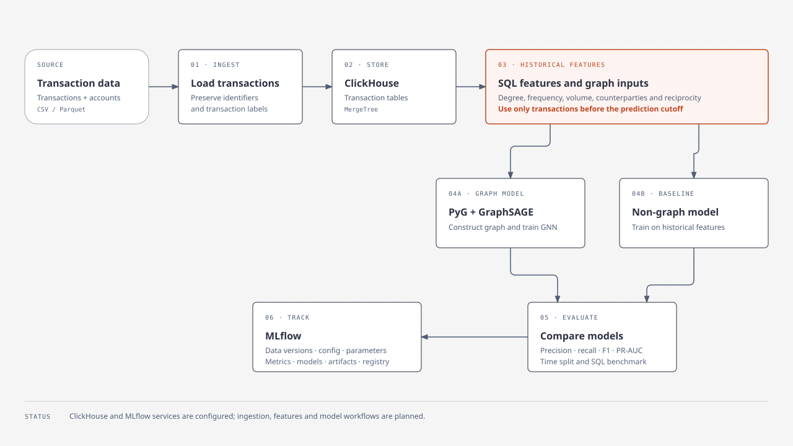

# ClickHouseGNN

A graph machine learning project for financial transaction networks. ClickHouse and MLflow run with Docker Compose; ingestion, feature engineering, and model training are planned.

## Setup

Install [uv](https://docs.astral.sh/uv/) and Docker Compose, then run:

```sh
uv sync                       # Python 3.12 environment
cp .env.example .env          # First time only; set your password in .env
docker compose up -d
```

On macOS, PyTorch uses the standard macOS build. CPU is available, and MPS may be available for Apple GPU acceleration.

## Services

- ClickHouse: [SQL interface](http://localhost:8123/play), HTTP port `8123`, native port `9000`. Log in with the credentials in `.env`.
- MLflow: [http://localhost:5000](http://localhost:5000). Set `MLFLOW_TRACKING_URI=http://localhost:5000` for training clients.

Both services bind to localhost. Their data is stored in `data/clickhouse` and `data/mlflow`, which Git ignores. MLflow uses SQLite for metadata and stores artifacts locally.

Run `docker compose down` to stop the services without deleting data. Changing `.env` after ClickHouse initializes does not update its existing user. Run Python with `uv run python` and tests with `uv run pytest`.

## Load the datasets

Place `HI-Small` and `LI-Small` under `dataset/`, then run:

```sh
uv run python scripts/ingest_datasets.py
```

The script creates two transaction tables and two account tables in ClickHouse, then inserts the CSV rows in batches. It reads credentials from `.env` or, if absent, `.env.example`. Each run clears those four dataset tables before importing, so it can be rerun after an interrupted load. Transaction account columns are stored separately as `from_account` and `to_account`. The table definitions are in `sql/schema.sql`.

## Planned workflow



[Open the HTML diagram](diagram/pipeline.html) in a browser. The diagram describes the planned workflow:

1. Ingest transaction and account data into ClickHouse MergeTree tables.
2. Compute historical node and edge features with SQL, using only transactions before the prediction cutoff.
3. Construct a PyTorch Geometric graph and train GraphSAGE alongside a non-graph baseline.
4. Compare precision, recall, F1, and PR-AUC; benchmark ClickHouse feature queries.
5. Record dataset versions, feature settings, parameters, metrics, and model artifacts in MLflow.

The services are configured; ingestion, feature engineering, model training, and evaluation are not yet implemented.
